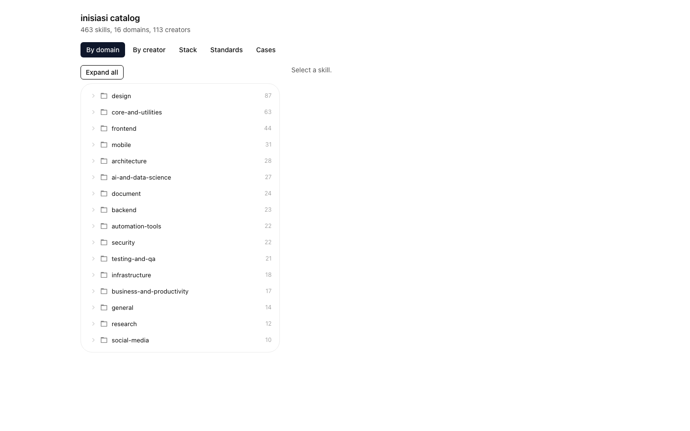

<div align="center">

# inisiasi

**Goals in. Stack, architecture and first tasks out.**

A kickoff skill and a local MCP server for coding agents.
It turns PLAN.md into a decided stack, architecture, first tasks, and the skills to install,
from a dated offline source of truth, so your agent builds instead of re-deciding.

[](LICENSE)
[](mcp/package.json)
[](#tools)

English · [Bahasa Indonesia](README_ID.md)

</div>

---

## Why

Starting a project with an agent usually means re-deciding the stack in every session. inisiasi settles it once, writes it down, and lets later sessions build.

- **It decides.** One choice per decision, one rejected alternative, and the reason. No menus.
- **It stops twice for you.** Once to confirm the plan, once to confirm the stack. Nothing is written before you say go.
- **It cites a source of truth.** 55 reference files, each stamped with the date it was last checked on the web. A file older than six months fails the test suite.
- **It runs locally.** The catalog is one JSON file. No network calls at runtime.

```
docs/PLAN.md  ──▶  inisiasi  ──▶  docs/ARCHITECTURE.md
                                  docs/TASKS.md
                                  AGENTS_WORKLOG.md
```

## Quick start

Requires Node 20 or newer.

> **Not on npm yet.** The `npx` commands in this section work once the package is published. Until then, use [From a checkout](#from-a-checkout).

### With npx

Install the two skills:

```sh
npx skills add cyuberpunk/inisiasi --full-depth -g -s inisiasi
npx skills add cyuberpunk/inisiasi --full-depth -g -s selera
```

Register the MCP server (Claude Code shown, others below):

```sh
claude mcp add inisiasi --scope user -- npx -y inisiasi-mcp
```

The package carries the catalog and the 55 reference files, so there is nothing else to download. Then open an empty repo and tell your agent: `inisiasi`.

### From a checkout

Also requires pnpm.

```sh
git clone https://github.com/cyuberpunk/inisiasi.git
cd inisiasi/mcp
pnpm install
pnpm test          # validates the catalog, builds, runs every tool

ln -s "$PWD/../skill/inisiasi" ~/.agents/skills/inisiasi
ln -s "$PWD/../skill/selera"   ~/.agents/skills/selera
claude mcp add inisiasi --scope user -- node "$PWD/dist/server.js"
```

## Examples

**1. Kick off a project.** Write the goals in `docs/PLAN.md`, then say `inisiasi`. The agent proposes a stack and waits. Say `go` and it writes `docs/ARCHITECTURE.md`, `docs/TASKS.md` (5 to 12 ordered tasks, the first one a risk spike) and a worklog entry. Existing docs are backed up first.

The commands below call the CLI as `node mcp/dist/cli.js` from a checkout. From npm, run `npx -p inisiasi-mcp inisiasi <command>` instead.

**2. Find skills for an idea.** No agent needed.

```sh
node mcp/dist/cli.js recommend "macOS menubar app in SwiftUI"
```

Output, trimmed to a few fields of the first match:

```json
[{ "id": "swiftui-expert-skill", "domain": "mobile", "creator": "AvdLee",
   "install_command": "npx skills add AvdLee/SwiftUI-Agent-Skill -g -s swiftui-expert-skill",
   "verified": true, "matched": ["swift", "swiftui", "macos"] }, …]
```

**3. See which references apply.**

```sh
node mcp/dist/cli.js select_references "SaaS app with Stripe billing and multi-tenant Postgres"
```

```
problems-critical.md, billing.md, multi-tenancy.md, architecture.md,
database.md, diagrams.md, problems-data.md, testing.md
```

**4. Check your docs against your own habits.** This reads the standards you recorded with the `selera` skill. With none recorded, the list is empty.

```sh
node mcp/dist/cli.js drift .
```

```json
{ "items": [
  { "key": "packageManager", "selera": "pnpm", "status": "ok", "note": "" },
  { "key": "validation", "selera": "zod", "status": "deviation",
    "note": "named in ARCHITECTURE but not as a Stack choice (rejected or not applied)" }, …],
  "sources": { "architecture": true, "tasks": true, "profile": true } }
```

## How the three parts fit

| Part | Scope | Job |
|------|-------|-----|
| **MCP server** | Tech and general | Serves a curated catalog of 439 skills across 15 domains. Every entry was checked against its source and its install command |
| **`inisiasi` skill** | Tech | From goals to stack, design and first tasks. Reads the source of truth, never recommends anything on an Avoid list |
| **`selera` skill** | Tech | Records your code standards, such as `fe.ui: shadcn` or `packageManager: pnpm`. A recorded choice steers recommendations, and `drift` flags docs that stopped matching it |

*Selera* is Indonesian for taste.

## Source of truth

`skill/inisiasi/references/sot/` holds 55 files: stack defaults, versions, patterns, security severity, and what to avoid. Each one starts with a `Last verified` date and a note on what was checked and what was not.

`pnpm test` fails when any file is older than six months. A GitHub Actions workflow runs it on every push, every pull request, and once a week.

The defaults lean toward their author: TypeScript with Vite+, native Apple platforms, Postgres, Cloudflare. If your project needs something else, name the deviation and the reason. Do not follow a default silently.

## Register in other agents

The blocks use a checkout. Replace `/absolute/path/to/inisiasi` with yours. From npm, use `npx` as the command and `["-y", "inisiasi-mcp"]` as the arguments.

<details>
<summary>Codex</summary>

```toml
# ~/.codex/config.toml
[mcp_servers.inisiasi]
command = "node"
args = ["/absolute/path/to/inisiasi/mcp/dist/server.js"]
```
</details>

<details>
<summary>opencode</summary>

```json
{
  "mcp": {
    "inisiasi": {
      "type": "local",
      "command": ["node", "/absolute/path/to/inisiasi/mcp/dist/server.js"],
      "enabled": true
    }
  }
}
```
</details>

<details>
<summary>Cursor</summary>

```json
{
  "mcpServers": {
    "inisiasi": { "command": "node", "args": ["/absolute/path/to/inisiasi/mcp/dist/server.js"] }
  }
}
```
</details>

## Tools

| Tool | Arguments |
|------|-----------|
| `list_domains` | none |
| `list_domain_skills` | `domain`, `limit?` |
| `recommend_skills` | `project_description`, `scope?`, `limit?` |
| `search_skills` | `query`, `domain?`, `limit?` |
| `get_skill` | `id` |
| `inspect_plan` | `path`, `max_questions?` |
| `validate_docs` | `root` |
| `detect_stack` | `root` |
| `select_references` | `project_description?`, `plan_path?`, `limit?` |
| `recommend_bundle` | `project_description?`, `root?`, `plan_path?`, `limit?` |

Every tool has a CLI twin: `node mcp/dist/cli.js <command>`. `limit` defaults to 8 and caps at 25. Entries marked `verified: false` are never recommended.

## Browse the catalog

```sh
cd web && pnpm install && pnpm dev
```

A local Vite and React browser for the catalog and the references. It is not hosted.



## Contributing

Pull requests are welcome. Read [CONTRIBUTING.md](CONTRIBUTING.md) first. Adding a catalog entry? Follow [mcp/catalog.md](mcp/catalog.md) and run `pnpm test` before you open the PR.

## License

[GPL-3.0-or-later](LICENSE). Use it for anything, commercial work included. If you distribute a modified version, you must release its source under the same license.

Changes to this project go through pull requests. See [CONTRIBUTING.md](CONTRIBUTING.md).
