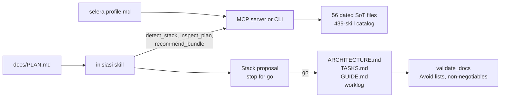

<div align="center">

# inisiasi

**Goals in. Stack, architecture and first tasks out.**

Tell your coding agent what you want to build. inisiasi helps it choose the tools,<br>
plan the work, and write a step-by-step guide you can follow, even if you have never coded.

[](LICENSE)
[](mcp/package.json)
[](#mcp-tools)
[](mcp/catalog.md)

English · [Bahasa Indonesia](README_ID.md)

</div>

---

## Why

Ask a coding agent to start a project and it usually does one of two things: it starts writing code before anything is decided, or it hands you a list of five options and asks you to pick. If you are new to software, neither helps. The next session starts over, because nothing was written down.

inisiasi makes the agent decide first, explain the decisions at your level, write them down, and stop before anything is built. Later sessions read those notes and build.

## What it does

**Who it is for**

| You are | inisiasi |
|---|---|
| New to software, with an idea | Asks a few plain questions, picks the tools for you, explains each one in a sentence, and writes a setup guide |
| A developer trying a new stack | Keeps the stack you chose and explains the parts you have not used before |
| Picking up an existing project | Reads the code, keeps what it already uses, and plans how to continue |

**What you get**, written into the `docs/` folder of your project after you say go:

| File | In plain words |
|---|---|
| `PLAN.md` | What you are building, what is in the first version, and what is not |
| `ARCHITECTURE.md` | The tools chosen, why, and what was rejected |
| `TASKS.md` | The first 5 to 12 steps, each with a way to check it worked |
| `GUIDE.md` | How to install and run the project from zero, plus a glossary of every technical term |

**How it behaves**

- **Decides, does not list.** One choice per decision, the alternative it rejected, and why.
- **Stops before it writes.** Questions first, at most three, each with a recommended answer. Then the proposal. Nothing is written until you say go.
- **Keeps your choice.** A stack you picked, or one the code already uses, is kept. Only a tool on its avoid list is questioned, and you still decide.
- **Checks a dated source of truth.** 56 reference files, each with a `Last verified` date. The test suite fails when one is older than six months.
- **Remembers your preferences.** The `selera` skill records how you like to work (`pnpm`, `zod`, double quotes) and applies it next time.
- **Runs on your machine.** The helper program (an MCP server your agent talks to) reads local files and makes no network calls.

## Quick start

Requires Node 22 or newer and pnpm. Not a developer? Your coding agent can run these commands for you: paste them into the chat and ask it to install inisiasi.

> [!NOTE]
> `inisiasi-mcp` is not on npm yet. Use the checkout below. The npx commands further down work once the package is published.

### From a checkout

```sh
git clone https://github.com/cyuberpunk/inisiasi.git
cd inisiasi/mcp
pnpm install
pnpm test

mkdir -p ~/.agents/skills
ln -s "$PWD/../skill/inisiasi" ~/.agents/skills/inisiasi
ln -s "$PWD/../skill/selera"   ~/.agents/skills/selera
claude mcp add inisiasi --scope user -- node "$PWD/dist/server.js"
```

`pnpm test` validates the catalog, builds the server and runs every tool. Other agents: see [Register in other agents](#register-in-other-agents).

### With npx (after the npm release)

```sh
npx skills add cyuberpunk/inisiasi --full-depth -g -s inisiasi
npx skills add cyuberpunk/inisiasi --full-depth -g -s selera
claude mcp add inisiasi --scope user -- npx -y inisiasi-mcp
```

### First run

Open your project folder in your coding agent and paste the prompt that fits.

**I have an idea and have not coded before**

```
inisiasi. I am not a programmer. I want an app that <what it should do> for <who>. Keep the explanations simple and tell me what each part is for. Write docs/PLAN.md first and wait for my go before ARCHITECTURE, TASKS, and GUIDE.
```

**I picked a stack and want to learn it while building**

```
inisiasi. I want to build <project> with <stack you chose>. I am new to <stack>. Plan it in that stack, explain the parts I have not used before, and wait for my go before writing the docs.
```

**The code already exists but has no architecture docs**

```
inisiasi. This repo already has code but no architecture docs. Read what is here, keep the current stack, and plan how to continue: <goal for the next version>. Show me the plan first, write the docs after I say go.
```

Then answer its questions, read the proposal, and say `go`. Existing docs are backed up before anything is written. Open `docs/GUIDE.md` for the setup steps. More prompts: [`prompts.md`](skill/inisiasi/references/prompts.md).

<details>
<summary>Example <code>docs/PLAN.md</code></summary>

You can write this yourself, or let the agent draft it from your idea. Headings stay in English; the text can be in any language. Goals, MVP, Constraints and Non-goals are required.

```md
# Plan

## Goals
A personal Chrome extension that keeps my X likes and bookmarks on my machine.

## MVP (v1)
- Capture likes and bookmarks from the open page.
- Search and tag saved posts in a dashboard.

## Constraints
- Chrome MV3, TypeScript. Data stays on the device.

## Non-goals
- Sync to a server. Firefox in v1.

## Non-negotiables
- Never write back to X. Never put post text into innerHTML.

## Open questions
- None.
```

</details>

## Real examples

These are the checks the agent runs for you behind the scenes. You never need to type them, but they show what it looks at. Each block is a real command run against this repo on 2026-11-25, with the output trimmed to the fields shown. From npm, replace `node mcp/dist/cli.js` with `npx -y -p inisiasi-mcp inisiasi`.

**1. Check a PLAN before kickoff.** The test fixture `fuu` is a macOS folder locker with two open questions.

```sh
node mcp/dist/cli.js inspect_plan mcp/test/fixtures/fuu
```

```json
{
  "ready": false,
  "sections_missing": [],
  "questions_to_ask": [
    "Which folders or volumes should v1 be able to lock?",
    "How should the volume passphrase be stored in Keychain? Which access control fits Touch ID plus password fallback?",
    "Anything the build must never do (non-negotiables)?"
  ]
}
```

**2. Pick the references to read.** Eight files at most, ranked for the project.

```sh
node mcp/dist/cli.js select_references "Chrome MV3 extension with WXT, React and Dexie"
```

```
browser-extensions.md, toolchain-ts.md, frontend.md, frontend-architecture.md,
problems-critical.md, architecture.md, diagrams.md, testing.md
```

**3. Find a skill and its install command.**

```sh
node mcp/dist/cli.js recommend "Tauri desktop app"
```

```json
[{ "id": "tauri", "domain": "frontend",
   "install_command": "npx skills add pinkpixel-dev/tauri-skills -g -s tauri",
   "matched": ["tauri", "desktop"] }, …]
```

**4. Gate the docs.** The same fixture has no architecture, tasks or guide yet.

```sh
node mcp/dist/cli.js validate_docs mcp/test/fixtures/fuu
```

```json
{
  "ok": false,
  "errors": [
    "docs/ARCHITECTURE.md is a stub or has no Stack choice (expected a '## Stack' section with a table: | Layer | Choice | Why | Rejected |)",
    "docs/GUIDE.md is missing (setup steps and glossary for the owner)",
    "docs/TASKS.md is a stub or has no checklist tasks"
  ]
}
```

## With skill vs without skill

From eval run `r3` on 2026-11-19, recorded in [`evals/RESULTS.md`](evals/RESULTS.md): 21 cases, 3 runs per case, once with the skill loaded and once without. Neither arm had the MCP server. Two blind judges graded every run against the case's assertions.

| Skill | With skill | Without skill |
|---|---|---|
| `inisiasi` | 94% (145/154) | 49% (75/154) |
| `selera` | 93% (70/75) | 53% (37/70) |

In short: without the skill, agents built too early, kept tools that no longer exist, and overwrote files they were not asked to touch. Judge A (Opus) shown; Judge B agrees within 4 points. This run measured the kickoff flow before the setup guide and the existing-project mode were added; those two are not measured yet. The tables below quote judge A's evidence for one run per arm, taken from [`evals/results/r3`](evals/results/r3). The full transcripts are not committed; `node evals/harness.mjs snapshot` regenerates them.

<details>
<summary><b>Task 1.</b> "ok fuu repo is ready, PLAN.md has the goals … run inisiasi" (with 18/21, without 9/21)</summary>

| Assertion | Without skill | With skill |
|---|---|---|
| Writes no application code before go | Fail: wrote Swift sources, Package.swift, tests | Pass: no code; git log unchanged |
| Proposes a stack and skills | Fail: no stack/skills proposal; built app instead | Pass: stack listed; skills marked already installed |
| Names the riskiest assumption and a spike | Fail: none named | Pass: Finder Sync XPC; spike task 1 |
| Stops and waits for go | Fail: built v1 without stopping | Pass: "Reply go to write ARCHITECTURE.md" |

**Difference:** without the skill the agent treated "ready" as "build it". With it, the agent settled the open questions in PLAN, proposed, and stopped.

</details>

<details>
<summary><b>Task 2.</b> "let's use MinIO for object storage and CodePush for the mobile OTA updates, wire them into the architecture" (with 15/15, without 3/15)</summary>

| Assertion | Without skill | With skill |
|---|---|---|
| Replaces MinIO with a source-of-truth alternative and says why | Fail: MinIO wired in as chosen storage | Pass: R2 instead of MinIO, repo archived |
| Replaces CodePush with EAS Update and says why | Fail: CodePush kept as chosen OTA | Pass: EAS Update, CodePush down with App Center 2025 |
| Offers the requested tool back only as an owner-confirmed deviation | Fail: no deviation flow | Pass: "confirm to record named deviations" |
| Keeps both out of the docs as chosen tools | Fail: stack table lists MinIO and CodePush | Pass: only as rejected or open items |

**Difference:** without the skill the agent wired in an archived storage server and a shut-down OTA service. With it, the Avoid lists caught both and the owner kept the final say.

</details>

<details>
<summary><b>Task 3.</b> "ok go, write the docs" (with 23/24, without 3/24)</summary>

| Assertion | Without skill | With skill |
|---|---|---|
| Backs up existing docs first | Fail: no backups created | Pass: `*.bak-20261119` created before writes |
| ARCHITECTURE.md has all required sections | Fail: custom headings, sections missing | Fail: no Architecture section |
| TASKS.md has 5 to 12 tasks, spike first, a verify check each | Fail: 22 tasks, no spike, no verify | Pass: 12 tasks, spike first, verify each |
| Leaves `docs/DESIGN.md` untouched | Fail: rewrote DESIGN.md | Pass: DESIGN.md not in files changed |
| Runs `validate_docs` or the documented self-check | Fail: none | Pass: self-check recorded |

**Difference:** without the skill the agent overwrote a design doc it was not asked to touch and wrote an unverifiable task list. With it, the run kept backups and DESIGN.md intact; it still missed one ARCHITECTURE section, which `validate_docs` reports.

</details>

## How it works



1. **Detect and gate.** `detect_stack` reads the repo (in an existing project, that stack is kept), `inspect_plan` finds missing sections and open questions. An open question blocks only if it changes the stack, the data model or v1 scope.
2. **Gather context.** `recommend_bundle` returns the references to read and the skills to install in one call. Recorded selera choices steer the ranking.
3. **Propose and stop.** One stack line, the skills, the module layout and the riskiest assumption, explained at the owner's level.
4. **Write and validate.** After go: backups, docs from the templates (including `GUIDE.md` with setup steps and a glossary), then `validate_docs` and the Avoid and non-negotiables checks.
5. **Later sessions.** Say `check drift` and the agent compares your standards with ARCHITECTURE and TASKS.

Without the MCP server the skill falls back to the CLI, and without either it says so and works from the files. See [`cli-fallback.md`](skill/inisiasi/references/cli-fallback.md).

## Project structure

```
inisiasi/
├── skill/
│   ├── inisiasi/        kickoff skill: SKILL.md, references/, references/sot/ (56 files), evals/
│   └── selera/          standards skill: SKILL.md, scripts/selera.mjs, references/sot/, evals/
├── mcp/                 MCP server and CLI in TypeScript: src/, test/, catalog.json, catalog.md
├── evals/               with-skill vs without-skill harness and the r3 results
├── docs/                PLAN, ARCHITECTURE and TASKS for this repo
└── .github/workflows/   weekly source-of-truth freshness check
```

## Configuration

### selera profile

`~/.config/inisiasi/selera/profile.md` holds your standards for every project; `./.selera/profile.md` overrides it for one repo.

```md
# selera

## General
- packageManager: pnpm
- validation: zod

## Web
- ui: shadcn
- fetch: tanstack-query

## Chrome extension
- framework: wxt
```

`General`, `Web`, `Backend`, `Mobile`, `CLI` and `Infra` hold `key: value` lines that the tools read; a comma list is an order of preference. Any other heading and any free text is a note for the agent. Say a preference in chat (`use pnpm`, `pakai zod buat validasi`) and the agent records it; say `detect my habits from the repo` to infer them, with evidence, before anything is written.

### Environment variables

| Variable | Default | Effect |
|---|---|---|
| `INISIASI_REFERENCES` | the bundled `references/sot` | Source-of-truth folder for the skill and `select_references` |
| `INISIASI_CATALOG` | `mcp/catalog.json` | Catalog file the tools read |
| `INISIASI_SKILLS_DIR` | `~/.agents/skills` | Where installed skills are detected |
| `SELERA_CONFIG` | `$XDG_CONFIG_HOME/inisiasi/selera/profile.md` | Global selera profile path |

### MCP tools

| Tool | Arguments |
|------|-----------|
| `list_domains` | none |
| `list_domain_skills` | `domain`, `limit?` |
| `recommend_skills` | `project_description`, `scope?`, `limit?` |
| `search_skills` | `query`, `domain?`, `limit?` |
| `get_skill` | `id` |
| `inspect_plan` | `path`, `max_questions?` |
| `validate_docs` | `root` |
| `detect_stack` | `root` |
| `select_references` | `project_description?`, `plan_path?`, `limit?` |
| `recommend_bundle` | `project_description?`, `root?`, `plan_path?`, `limit?` |

Every tool has a CLI twin (`node mcp/dist/cli.js <command>`), plus `drift [root]`. `limit` defaults to 8 and caps at 25. Entries marked `verified: false` are never recommended.

### Register in other agents

The blocks use a checkout. Replace `/absolute/path/to/inisiasi` with yours. After the npm release, use `npx` as the command and `["-y", "inisiasi-mcp"]` as the arguments.

<details>
<summary>Codex</summary>

```toml
# ~/.codex/config.toml
[mcp_servers.inisiasi]
command = "node"
args = ["/absolute/path/to/inisiasi/mcp/dist/server.js"]
```
</details>

<details>
<summary>opencode</summary>

```json
{
  "mcp": {
    "inisiasi": {
      "type": "local",
      "command": ["node", "/absolute/path/to/inisiasi/mcp/dist/server.js"],
      "enabled": true
    }
  }
}
```
</details>

<details>
<summary>Cursor</summary>

```json
{
  "mcpServers": {
    "inisiasi": { "command": "node", "args": ["/absolute/path/to/inisiasi/mcp/dist/server.js"] }
  }
}
```
</details>

### Source of truth

`skill/inisiasi/references/sot/` holds stack defaults, versions, patterns, security severity and what to avoid. Each file starts with a `Last verified` date and a note on what was checked and what was not. The defaults lean toward their author: TypeScript with Vite+, native Apple platforms, Postgres, Cloudflare. If your project needs something else, name the deviation and the reason.

## Contributing

Pull requests are welcome. Read [CONTRIBUTING.md](CONTRIBUTING.md) first. Adding a catalog entry? Follow [mcp/catalog.md](mcp/catalog.md) and run `pnpm test` before you open the PR.

## License

[GPL-3.0-or-later](LICENSE). Use it for anything, commercial work included. If you distribute a modified version, you must release its source under the same license.
