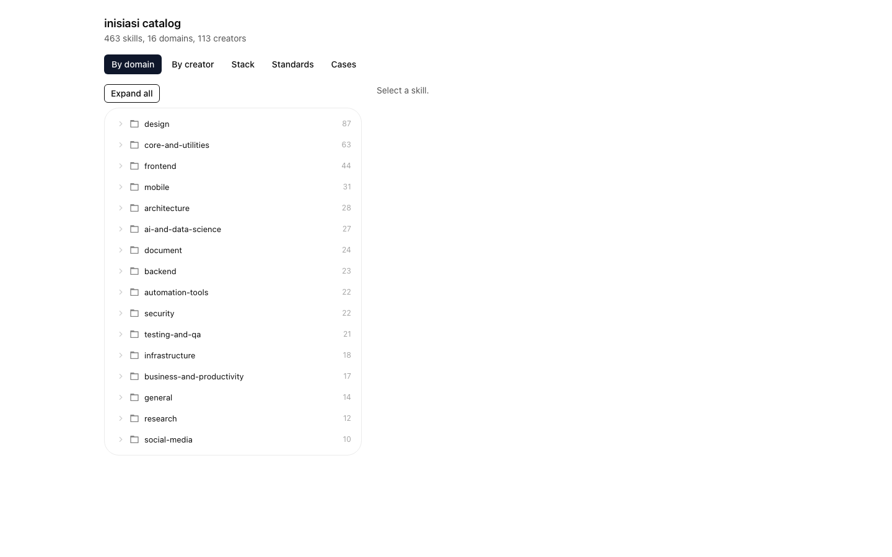

<div align="center">

# inisiasi

**Tujuan masuk. Stack, arsitektur, dan tugas pertama keluar.**

Skill kickoff dan MCP server lokal untuk coding agent.
Ia mengubah PLAN.md menjadi stack, arsitektur, tugas pertama, dan skill yang perlu dipasang,
semuanya diputuskan dari source of truth offline yang bertanggal, supaya agent kamu langsung membangun tanpa memutuskan ulang.

[](LICENSE)
[](mcp/package.json)
[](#tools)

[English](README.md) · Bahasa Indonesia

</div>

---

## Kenapa

Memulai proyek dengan agent biasanya berarti memutuskan ulang stack di setiap sesi. inisiasi menyelesaikannya sekali, menuliskannya, dan membiarkan sesi berikutnya langsung membangun.

- **Ia memutuskan.** Satu pilihan per keputusan, satu alternatif yang ditolak, beserta alasannya. Tanpa menu.
- **Ia berhenti dua kali untuk kamu.** Sekali untuk konfirmasi rencana, sekali untuk konfirmasi stack. Tidak ada yang ditulis sebelum kamu bilang go.
- **Ia merujuk ke source of truth.** 55 file referensi, masing-masing bertanggal verifikasi terakhir di web. File yang lebih tua dari enam bulan membuat tes gagal.
- **Berjalan lokal.** Katalognya satu file JSON. Tidak ada panggilan jaringan saat runtime.

```
docs/PLAN.md  ──▶  inisiasi  ──▶  docs/ARCHITECTURE.md
                                  docs/TASKS.md
                                  AGENTS_WORKLOG.md
```

## Mulai cepat

Butuh Node 20 ke atas.

> **Belum ada di npm.** Perintah `npx` di bagian ini baru berfungsi setelah paketnya dipublikasikan. Sampai saat itu, pakai [Dari checkout](#dari-checkout).

### Dengan npx

Pasang dua skill:

```sh
npx skills add cyuberpunk/inisiasi --full-depth -g -s inisiasi
npx skills add cyuberpunk/inisiasi --full-depth -g -s selera
```

Daftarkan MCP server (contoh Claude Code, yang lain di bawah):

```sh
claude mcp add inisiasi --scope user -- npx -y inisiasi-mcp
```

Paketnya membawa katalog dan 55 file referensi, jadi tidak ada lagi yang perlu diunduh. Lalu buka repo kosong dan bilang ke agent kamu: `inisiasi`.

### Dari checkout

Butuh pnpm juga.

```sh
git clone https://github.com/cyuberpunk/inisiasi.git
cd inisiasi/mcp
pnpm install
pnpm test          # validasi katalog, build, jalankan setiap tool

ln -s "$PWD/../skill/inisiasi" ~/.agents/skills/inisiasi
ln -s "$PWD/../skill/selera"   ~/.agents/skills/selera
claude mcp add inisiasi --scope user -- node "$PWD/dist/server.js"
```

## Contoh

**1. Memulai proyek.** Tulis tujuan di `docs/PLAN.md`, lalu ucapkan `inisiasi`. Agent mengusulkan stack dan menunggu. Bilang `go`, dan ia menulis `docs/ARCHITECTURE.md`, `docs/TASKS.md` (5 sampai 12 tugas berurutan, yang pertama berupa spike risiko), dan satu entri worklog. Dokumen lama dicadangkan dulu.

Perintah di bawah memanggil CLI sebagai `node mcp/dist/cli.js` dari checkout. Dari npm, jalankan `npx -p inisiasi-mcp inisiasi <perintah>`.

**2. Mencari skill untuk sebuah ide.** Tanpa agent.

```sh
node mcp/dist/cli.js recommend "macOS menubar app in SwiftUI"
```

Output, dipangkas ke beberapa field dari hasil pertama:

```json
[{ "id": "swiftui-expert-skill", "domain": "mobile", "creator": "AvdLee",
   "install_command": "npx skills add AvdLee/SwiftUI-Agent-Skill -g -s swiftui-expert-skill",
   "verified": true, "matched": ["swift", "swiftui", "macos"] }, …]
```

**3. Melihat referensi yang relevan.**

```sh
node mcp/dist/cli.js select_references "SaaS app with Stripe billing and multi-tenant Postgres"
```

```
problems-critical.md, billing.md, multi-tenancy.md, architecture.md,
database.md, diagrams.md, problems-data.md, testing.md
```

**4. Mencocokkan dokumen dengan kebiasaanmu sendiri.** Ini membaca standar yang kamu catat lewat skill `selera`. Kalau belum ada yang tercatat, daftarnya kosong.

```sh
node mcp/dist/cli.js drift .
```

```json
{ "items": [
  { "key": "packageManager", "selera": "pnpm", "status": "ok", "note": "" },
  { "key": "validation", "selera": "zod", "status": "deviation",
    "note": "named in ARCHITECTURE but not as a Stack choice (rejected or not applied)" }, …],
  "sources": { "architecture": true, "tasks": true, "profile": true } }
```

## Cara tiga bagian bekerja bersama

| Bagian | Cakupan | Tugas |
|--------|---------|-------|
| **MCP server** | Tech dan umum | Menyajikan katalog 439 skill di 15 domain. Setiap entri sudah dicek ke sumbernya dan perintah instalnya |
| **Skill `inisiasi`** | Tech | Dari tujuan ke stack, desain, dan tugas pertama. Membaca source of truth, tidak pernah merekomendasikan apa pun yang ada di daftar Avoid |
| **Skill `selera`** | Tech | Mencatat standar kode kamu, misalnya `fe.ui: shadcn` atau `packageManager: pnpm`. Pilihan yang tercatat mengarahkan rekomendasi, dan `drift` menandai dokumen yang tidak lagi cocok |

*Selera* artinya preferensi pribadi.

## Source of truth

`skill/inisiasi/references/sot/` berisi 55 file: default stack, versi, pola, tingkat keparahan keamanan, dan apa yang dihindari. Setiap file diawali tanggal `Last verified` dan catatan tentang apa yang sudah dicek dan apa yang belum.

`pnpm test` gagal kalau ada file yang lebih tua dari enam bulan. Workflow GitHub Actions menjalankannya di setiap push, setiap pull request, dan seminggu sekali.

Defaultnya condong ke penulisnya: TypeScript dengan Vite+, platform Apple native, Postgres, Cloudflare. Kalau proyekmu butuh yang lain, sebutkan penyimpangannya beserta alasannya. Jangan mengikuti default secara diam-diam.

## Daftar di agent lain

Blok di bawah memakai checkout. Ganti `/absolute/path/to/inisiasi` dengan milikmu. Dari npm, pakai `npx` sebagai command dan `["-y", "inisiasi-mcp"]` sebagai argumen.

<details>
<summary>Codex</summary>

```toml
# ~/.codex/config.toml
[mcp_servers.inisiasi]
command = "node"
args = ["/absolute/path/to/inisiasi/mcp/dist/server.js"]
```
</details>

<details>
<summary>opencode</summary>

```json
{
  "mcp": {
    "inisiasi": {
      "type": "local",
      "command": ["node", "/absolute/path/to/inisiasi/mcp/dist/server.js"],
      "enabled": true
    }
  }
}
```
</details>

<details>
<summary>Cursor</summary>

```json
{
  "mcpServers": {
    "inisiasi": { "command": "node", "args": ["/absolute/path/to/inisiasi/mcp/dist/server.js"] }
  }
}
```
</details>

## Tools

| Tool | Argumen |
|------|---------|
| `list_domains` | tidak ada |
| `list_domain_skills` | `domain`, `limit?` |
| `recommend_skills` | `project_description`, `scope?`, `limit?` |
| `search_skills` | `query`, `domain?`, `limit?` |
| `get_skill` | `id` |
| `inspect_plan` | `path`, `max_questions?` |
| `validate_docs` | `root` |
| `detect_stack` | `root` |
| `select_references` | `project_description?`, `plan_path?`, `limit?` |
| `recommend_bundle` | `project_description?`, `root?`, `plan_path?`, `limit?` |

Setiap tool punya padanan CLI: `node mcp/dist/cli.js <perintah>`. `limit` bawaannya 8 dan maksimal 25. Entri bertanda `verified: false` tidak pernah direkomendasikan.

## Jelajahi katalog

```sh
cd web && pnpm install && pnpm dev
```

Browser lokal berbasis Vite dan React untuk katalog dan referensinya. Tidak di-hosting.



## Berkontribusi

Pull request diterima. Baca [CONTRIBUTING.md](CONTRIBUTING.md) dulu. Mau menambah entri katalog? Ikuti [mcp/catalog.md](mcp/catalog.md) dan jalankan `pnpm test` sebelum membuka PR.

## Lisensi

[GPL-3.0-or-later](LICENSE). Pakai untuk apa saja, termasuk pekerjaan komersial. Kalau kamu membagikan versi yang sudah diubah, kamu wajib merilis sumber kodenya dengan lisensi yang sama.

Perubahan pada proyek ini lewat pull request. Lihat [CONTRIBUTING.md](CONTRIBUTING.md).
