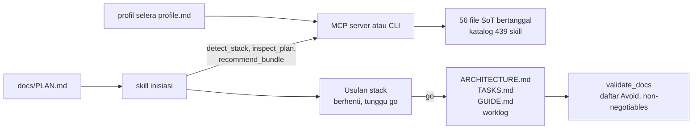

<div align="center">

# inisiasi

**Tujuan masuk. Stack, arsitektur, dan tugas pertama keluar.**

Ceritakan ke coding agent kamu apa yang mau dibuat. inisiasi membantunya memilih alat,<br>
merencanakan pekerjaan, dan menulis panduan langkah demi langkah yang bisa kamu ikuti, walaupun kamu belum pernah coding.

[](LICENSE)
[](mcp/package.json)
[](#tool-mcp)
[](mcp/catalog.md)

[English](README.md) · Bahasa Indonesia

</div>

---

## Kenapa

Minta coding agent memulai proyek, biasanya ia melakukan salah satu dari dua hal: langsung menulis kode sebelum ada yang diputuskan, atau memberi lima pilihan dan menyuruh kamu memilih. Kalau kamu baru di dunia software, keduanya tidak membantu. Sesi berikutnya mulai dari nol lagi, karena tidak ada yang dicatat.

inisiasi membuat agent memutuskan dulu, menjelaskan keputusannya sesuai level kamu, mencatatnya, dan berhenti sebelum ada yang dibangun. Sesi berikutnya membaca catatan itu lalu membangun.

## Apa yang dilakukan

**Untuk siapa**

| Kamu | inisiasi |
|---|---|
| Baru di dunia software, punya ide | Mengajukan beberapa pertanyaan sederhana, memilihkan alatnya, menjelaskan masing-masing dalam satu kalimat, dan menulis panduan setup |
| Developer yang mencoba stack baru | Mempertahankan stack pilihanmu dan menjelaskan bagian yang belum pernah kamu pakai |
| Melanjutkan proyek yang sudah ada | Membaca kodenya, mempertahankan yang sudah dipakai, dan merencanakan kelanjutannya |

**Yang kamu dapat**, ditulis ke folder `docs/` proyekmu setelah kamu bilang go:

| File | Dalam bahasa sederhana |
|---|---|
| `PLAN.md` | Apa yang dibangun, apa yang masuk versi pertama, dan apa yang tidak |
| `ARCHITECTURE.md` | Alat yang dipilih, alasannya, dan yang ditolak |
| `TASKS.md` | 5 sampai 12 langkah pertama, masing-masing dengan cara mengecek hasilnya |
| `GUIDE.md` | Cara memasang dan menjalankan proyek dari nol, plus glosarium setiap istilah teknis |

**Cara kerjanya**

- **Memutuskan, bukan memberi daftar.** Satu pilihan per keputusan, alternatif yang ditolak, dan alasannya.
- **Berhenti sebelum menulis.** Pertanyaan dulu, paling banyak tiga, masing-masing dengan jawaban yang disarankan. Lalu usulan. Tidak ada yang ditulis sebelum kamu bilang go.
- **Mempertahankan pilihanmu.** Stack yang kamu pilih, atau yang sudah dipakai kode, dipertahankan. Hanya alat yang masuk daftar hindari yang dipertanyakan, dan keputusan tetap di tangan kamu.
- **Merujuk source of truth bertanggal.** 56 file referensi, masing-masing dengan tanggal `Last verified`. Tes gagal kalau ada yang lebih tua dari enam bulan.
- **Mengingat preferensimu.** Skill `selera` mencatat cara kerja yang kamu suka (`pnpm`, `zod`, petik ganda) dan menerapkannya di sesi berikutnya.
- **Berjalan di mesinmu.** Program pembantunya (MCP server yang diajak bicara oleh agent) membaca file lokal dan tidak memanggil jaringan.

## Mulai cepat

Butuh Node 22 ke atas dan pnpm. Bukan developer? Coding agent kamu bisa menjalankan perintah ini untukmu: tempel ke chat dan minta ia memasang inisiasi.

> [!NOTE]
> `inisiasi-mcp` belum ada di npm. Pakai checkout di bawah. Perintah npx di bagian berikutnya baru berfungsi setelah paketnya dipublikasikan.

### Dari checkout

```sh
git clone https://github.com/cyuberpunk/inisiasi.git
cd inisiasi/mcp
pnpm install
pnpm test

mkdir -p ~/.agents/skills
ln -s "$PWD/../skill/inisiasi" ~/.agents/skills/inisiasi
ln -s "$PWD/../skill/selera"   ~/.agents/skills/selera
claude mcp add inisiasi --scope user -- node "$PWD/dist/server.js"
```

`pnpm test` memvalidasi katalog, mem-build server, dan menjalankan setiap tool. Agent lain: lihat [Daftarkan di agent lain](#daftarkan-di-agent-lain).

### Dengan npx (setelah rilis npm)

```sh
npx skills add cyuberpunk/inisiasi --full-depth -g -s inisiasi
npx skills add cyuberpunk/inisiasi --full-depth -g -s selera
claude mcp add inisiasi --scope user -- npx -y inisiasi-mcp
```

### Pertama kali dipakai

Buka folder proyekmu di coding agent, lalu tempel prompt yang sesuai.

**Saya punya ide dan belum pernah coding**

```
inisiasi. Saya bukan programmer. Saya mau aplikasi yang <apa yang harus dilakukan> untuk <siapa>. Jelaskan dengan sederhana dan beri tahu fungsi tiap bagian. Tulis docs/PLAN.md dulu dan tunggu go dari saya sebelum ARCHITECTURE, TASKS, dan GUIDE.
```

**Saya sudah memilih stack dan mau belajar sambil membangun**

```
inisiasi. Saya mau membangun <proyek> dengan <stack pilihanmu>. Saya baru di <stack>. Rencanakan dengan stack itu, jelaskan bagian yang belum pernah saya pakai, dan tunggu go dari saya sebelum menulis docs.
```

**Kodenya sudah ada tapi belum punya dokumen arsitektur**

```
inisiasi. Repo ini sudah ada kodenya tapi belum ada dokumen arsitektur. Baca yang ada, pertahankan stack sekarang, dan rencanakan kelanjutannya: <tujuan versi berikutnya>. Tunjukkan rencananya dulu, tulis docs setelah saya bilang go.
```

Lalu jawab pertanyaannya, baca usulannya, dan bilang `go`. Dokumen yang sudah ada dicadangkan sebelum ditimpa. Buka `docs/GUIDE.md` untuk langkah setup. Prompt lain: [`prompts.md`](skill/inisiasi/references/prompts.md).

<details>
<summary>Contoh <code>docs/PLAN.md</code></summary>

Kamu bisa menulisnya sendiri, atau biarkan agent menyusun drafnya dari idemu. Judul section tetap bahasa Inggris; isinya boleh bahasa apa saja. Goals, MVP, Constraints, dan Non-goals wajib.

```md
# Plan

## Goals
Ekstensi Chrome pribadi yang menyimpan likes dan bookmark X saya di perangkat sendiri.

## MVP (v1)
- Ambil likes dan bookmark dari halaman yang sedang dibuka.
- Cari dan beri tag postingan tersimpan di dashboard.

## Constraints
- Chrome MV3, TypeScript. Data tetap di perangkat.

## Non-goals
- Sinkronisasi ke server. Firefox di v1.

## Non-negotiables
- Jangan pernah menulis balik ke X. Jangan pernah memasukkan teks postingan lewat innerHTML.

## Open questions
- Tidak ada.
```

</details>

## Contoh nyata

Ini pengecekan yang dijalankan agent untukmu di balik layar. Kamu tidak perlu mengetiknya, tapi contoh ini menunjukkan apa yang ia periksa. Setiap blok adalah perintah sungguhan yang dijalankan di repo ini pada 2026-11-25, dengan output dipotong ke field yang ditampilkan. Dari npm, ganti `node mcp/dist/cli.js` dengan `npx -y -p inisiasi-mcp inisiasi`.

**1. Cek PLAN sebelum kickoff.** Fixture tes `fuu` adalah pengunci folder macOS dengan dua pertanyaan terbuka.

```sh
node mcp/dist/cli.js inspect_plan mcp/test/fixtures/fuu
```

```json
{
  "ready": false,
  "sections_missing": [],
  "questions_to_ask": [
    "Which folders or volumes should v1 be able to lock?",
    "How should the volume passphrase be stored in Keychain? Which access control fits Touch ID plus password fallback?",
    "Anything the build must never do (non-negotiables)?"
  ]
}
```

**2. Pilih referensi yang perlu dibaca.** Paling banyak delapan file, diurutkan untuk proyeknya.

```sh
node mcp/dist/cli.js select_references "Chrome MV3 extension with WXT, React and Dexie"
```

```
browser-extensions.md, toolchain-ts.md, frontend.md, frontend-architecture.md,
problems-critical.md, architecture.md, diagrams.md, testing.md
```

**3. Cari skill beserta perintah instalnya.**

```sh
node mcp/dist/cli.js recommend "Tauri desktop app"
```

```json
[{ "id": "tauri", "domain": "frontend",
   "install_command": "npx skills add pinkpixel-dev/tauri-skills -g -s tauri",
   "matched": ["tauri", "desktop"] }, …]
```

**4. Gerbang untuk docs.** Fixture yang sama belum punya arsitektur, tugas, dan panduan.

```sh
node mcp/dist/cli.js validate_docs mcp/test/fixtures/fuu
```

```json
{
  "ok": false,
  "errors": [
    "docs/ARCHITECTURE.md is a stub or has no Stack choice (expected a '## Stack' section with a table: | Layer | Choice | Why | Rejected |)",
    "docs/GUIDE.md is missing (setup steps and glossary for the owner)",
    "docs/TASKS.md is a stub or has no checklist tasks"
  ]
}
```

## Dengan skill vs tanpa skill

Dari eval run `r3` pada 2026-11-19, dicatat di [`evals/RESULTS.md`](evals/RESULTS.md): 21 kasus, 3 run per kasus, sekali dengan skill dan sekali tanpa. Kedua arm tidak memakai MCP server. Dua juri buta menilai setiap run terhadap assertion kasusnya.

| Skill | Dengan skill | Tanpa skill |
|---|---|---|
| `inisiasi` | 94% (145/154) | 49% (75/154) |
| `selera` | 93% (70/75) | 53% (37/70) |

Singkatnya: tanpa skill, agent membangun terlalu cepat, memakai alat yang sudah tidak ada, dan menimpa file yang tidak diminta. Yang ditampilkan juri A (Opus); juri B berbeda paling banyak 4 poin. Run ini mengukur alur kickoff sebelum panduan setup dan mode proyek lama ditambahkan; keduanya belum diukur. Tabel di bawah mengutip bukti juri A (dalam bahasa Inggris, apa adanya) untuk satu run per arm, dari [`evals/results/r3`](evals/results/r3). Transkrip lengkapnya tidak di-commit; `node evals/harness.mjs snapshot` membuatnya ulang.

<details>
<summary><b>Tugas 1.</b> "ok fuu repo is ready, PLAN.md has the goals … run inisiasi" (dengan 18/21, tanpa 9/21)</summary>

| Assertion | Tanpa skill | Dengan skill |
|---|---|---|
| Tidak menulis kode aplikasi sebelum go | Fail: wrote Swift sources, Package.swift, tests | Pass: no code; git log unchanged |
| Mengusulkan stack dan skill | Fail: no stack/skills proposal; built app instead | Pass: stack listed; skills marked already installed |
| Menyebut asumsi paling berisiko dan spike-nya | Fail: none named | Pass: Finder Sync XPC; spike task 1 |
| Berhenti dan menunggu go | Fail: built v1 without stopping | Pass: "Reply go to write ARCHITECTURE.md" |

**Bedanya:** tanpa skill, agent mengartikan "ready" sebagai "bangun sekarang". Dengan skill, agent menyelesaikan pertanyaan terbuka di PLAN, mengusulkan, lalu berhenti.

</details>

<details>
<summary><b>Tugas 2.</b> "let's use MinIO for object storage and CodePush for the mobile OTA updates, wire them into the architecture" (dengan 15/15, tanpa 3/15)</summary>

| Assertion | Tanpa skill | Dengan skill |
|---|---|---|
| Mengganti MinIO dengan alternatif dari source of truth dan menjelaskan alasannya | Fail: MinIO wired in as chosen storage | Pass: R2 instead of MinIO, repo archived |
| Mengganti CodePush dengan EAS Update dan menjelaskan alasannya | Fail: CodePush kept as chosen OTA | Pass: EAS Update, CodePush down with App Center 2025 |
| Menawarkan alat yang diminta hanya sebagai deviasi yang dikonfirmasi pemilik | Fail: no deviation flow | Pass: "confirm to record named deviations" |
| Tidak menulis keduanya sebagai pilihan di docs | Fail: stack table lists MinIO and CodePush | Pass: only as rejected or open items |

**Bedanya:** tanpa skill, agent memasang server storage yang repo-nya sudah diarsipkan dan layanan OTA yang sudah tutup. Dengan skill, daftar Avoid menangkap keduanya dan keputusan akhir tetap di pemilik.

</details>

<details>
<summary><b>Tugas 3.</b> "ok go, write the docs" (dengan 23/24, tanpa 3/24)</summary>

| Assertion | Tanpa skill | Dengan skill |
|---|---|---|
| Mencadangkan dokumen lama dulu | Fail: no backups created | Pass: `*.bak-20261119` created before writes |
| ARCHITECTURE.md punya semua section wajib | Fail: custom headings, sections missing | Fail: no Architecture section |
| TASKS.md berisi 5 sampai 12 tugas, spike pertama, tiap tugas ada cek | Fail: 22 tasks, no spike, no verify | Pass: 12 tasks, spike first, verify each |
| Tidak menyentuh `docs/DESIGN.md` | Fail: rewrote DESIGN.md | Pass: DESIGN.md not in files changed |
| Menjalankan `validate_docs` atau self-check yang terdokumentasi | Fail: none | Pass: self-check recorded |

**Bedanya:** tanpa skill, agent menimpa dokumen desain yang tidak diminta dan menulis daftar tugas yang tidak bisa dicek. Dengan skill, run ini menyimpan cadangan dan DESIGN.md tetap utuh; masih ada satu section ARCHITECTURE yang terlewat, dan itu dilaporkan `validate_docs`.

</details>

## Cara kerja



1. **Deteksi dan gerbang.** `detect_stack` membaca repo (di proyek lama, stack-nya dipertahankan), `inspect_plan` mencari section yang kurang dan pertanyaan terbuka. Pertanyaan terbuka hanya menahan kalau mengubah stack, data model, atau scope v1.
2. **Kumpulkan konteks.** `recommend_bundle` mengembalikan referensi yang perlu dibaca dan skill yang perlu dipasang dalam satu panggilan. Pilihan yang tercatat di selera ikut mengarahkan urutannya.
3. **Usulkan dan berhenti.** Satu baris stack, skill, susunan modul, dan asumsi paling berisiko, dijelaskan sesuai level pemilik.
4. **Tulis dan validasi.** Setelah go: cadangan, docs dari template (termasuk `GUIDE.md` berisi langkah setup dan glosarium), lalu `validate_docs` serta cek Avoid dan non-negotiables.
5. **Sesi berikutnya.** Bilang `cek drift` dan agent membandingkan standarmu dengan ARCHITECTURE dan TASKS.

Tanpa MCP server, skill memakai CLI; tanpa keduanya, ia bilang terus terang dan bekerja dari file. Lihat [`cli-fallback.md`](skill/inisiasi/references/cli-fallback.md).

## Struktur proyek

```
inisiasi/
├── skill/
│   ├── inisiasi/        skill kickoff: SKILL.md, references/, references/sot/ (56 file), evals/
│   └── selera/          skill standar: SKILL.md, scripts/selera.mjs, references/sot/, evals/
├── mcp/                 MCP server dan CLI dalam TypeScript: src/, test/, catalog.json, catalog.md
├── evals/               harness dengan skill vs tanpa skill dan hasil r3
├── docs/                PLAN, ARCHITECTURE, dan TASKS untuk repo ini
└── .github/workflows/   cek mingguan kesegaran source of truth
```

## Konfigurasi

### Profil selera

`~/.config/inisiasi/selera/profile.md` menyimpan standarmu untuk semua proyek; `./.selera/profile.md` menimpanya untuk satu repo.

```md
# selera

## General
- packageManager: pnpm
- validation: zod

## Web
- ui: shadcn
- fetch: tanstack-query

## Chrome extension
- framework: wxt
```

`General`, `Web`, `Backend`, `Mobile`, `CLI`, dan `Infra` berisi baris `key: value` yang dibaca tool; daftar dengan koma berarti urutan preferensi. Heading lain dan teks bebas adalah catatan untuk agent. Sampaikan preferensi di chat (`pakai pnpm`, `use zod for validation`) dan agent mencatatnya; bilang `lihat kebiasaan saya dari repo` untuk menyimpulkannya, lengkap dengan bukti, sebelum ada yang ditulis.

### Variabel lingkungan

| Variabel | Bawaan | Efek |
|---|---|---|
| `INISIASI_REFERENCES` | `references/sot` bawaan | Folder source of truth untuk skill dan `select_references` |
| `INISIASI_CATALOG` | `mcp/catalog.json` | File katalog yang dibaca tool |
| `INISIASI_SKILLS_DIR` | `~/.agents/skills` | Tempat skill terpasang dideteksi |
| `SELERA_CONFIG` | `$XDG_CONFIG_HOME/inisiasi/selera/profile.md` | Lokasi profil selera global |

### Tool MCP

| Tool | Argumen |
|------|-----------|
| `list_domains` | tidak ada |
| `list_domain_skills` | `domain`, `limit?` |
| `recommend_skills` | `project_description`, `scope?`, `limit?` |
| `search_skills` | `query`, `domain?`, `limit?` |
| `get_skill` | `id` |
| `inspect_plan` | `path`, `max_questions?` |
| `validate_docs` | `root` |
| `detect_stack` | `root` |
| `select_references` | `project_description?`, `plan_path?`, `limit?` |
| `recommend_bundle` | `project_description?`, `root?`, `plan_path?`, `limit?` |

Setiap tool punya padanan CLI (`node mcp/dist/cli.js <perintah>`), ditambah `drift [root]`. `limit` bawaannya 8 dan maksimal 25. Entri bertanda `verified: false` tidak pernah direkomendasikan.

### Daftarkan di agent lain

Blok di bawah memakai checkout. Ganti `/absolute/path/to/inisiasi` dengan milikmu. Setelah rilis npm, pakai `npx` sebagai command dan `["-y", "inisiasi-mcp"]` sebagai argumen.

<details>
<summary>Codex</summary>

```toml
# ~/.codex/config.toml
[mcp_servers.inisiasi]
command = "node"
args = ["/absolute/path/to/inisiasi/mcp/dist/server.js"]
```
</details>

<details>
<summary>opencode</summary>

```json
{
  "mcp": {
    "inisiasi": {
      "type": "local",
      "command": ["node", "/absolute/path/to/inisiasi/mcp/dist/server.js"],
      "enabled": true
    }
  }
}
```
</details>

<details>
<summary>Cursor</summary>

```json
{
  "mcpServers": {
    "inisiasi": { "command": "node", "args": ["/absolute/path/to/inisiasi/mcp/dist/server.js"] }
  }
}
```
</details>

### Source of truth

`skill/inisiasi/references/sot/` berisi default stack, versi, pola, tingkat keparahan keamanan, dan apa yang dihindari. Setiap file diawali tanggal `Last verified` dan catatan tentang apa yang dicek dan apa yang belum. Default-nya condong ke selera penulisnya: TypeScript dengan Vite+, platform native Apple, Postgres, Cloudflare. Kalau proyekmu butuh yang lain, sebutkan deviasinya dan alasannya.

## Berkontribusi

Pull request diterima. Baca [CONTRIBUTING.md](CONTRIBUTING.md) dulu. Mau menambah entri katalog? Ikuti [mcp/catalog.md](mcp/catalog.md) dan jalankan `pnpm test` sebelum membuka PR.

## Lisensi

[GPL-3.0-or-later](LICENSE). Pakai untuk apa saja, termasuk pekerjaan komersial. Kalau kamu membagikan versi yang sudah diubah, kamu wajib merilis sumber kodenya dengan lisensi yang sama.
